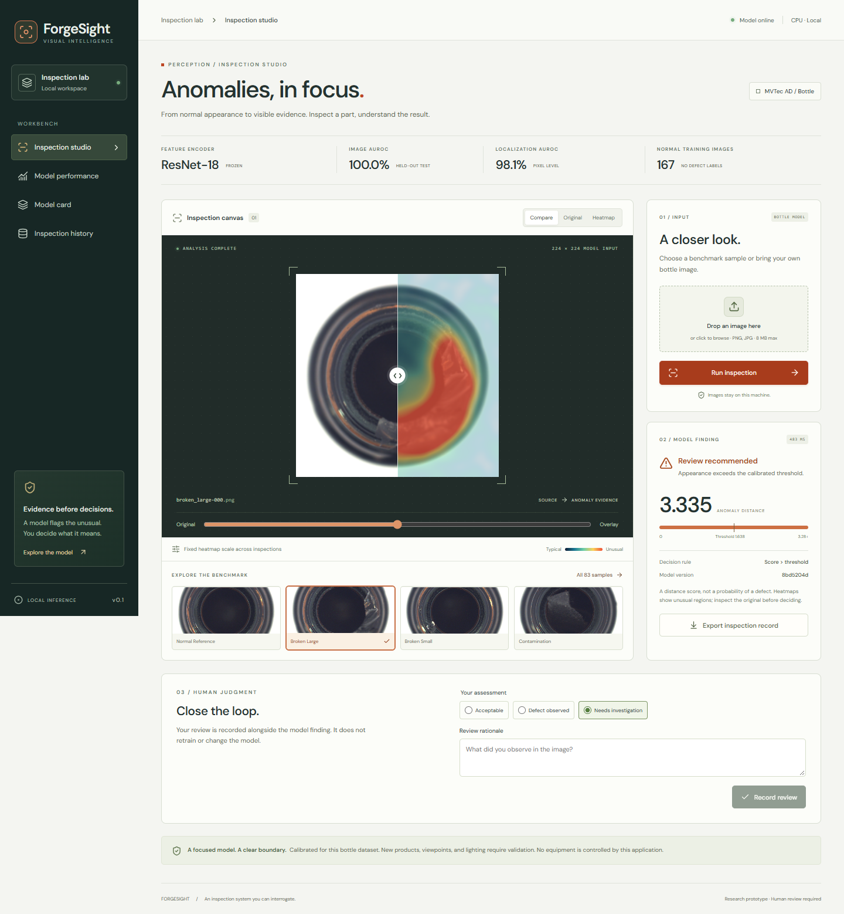
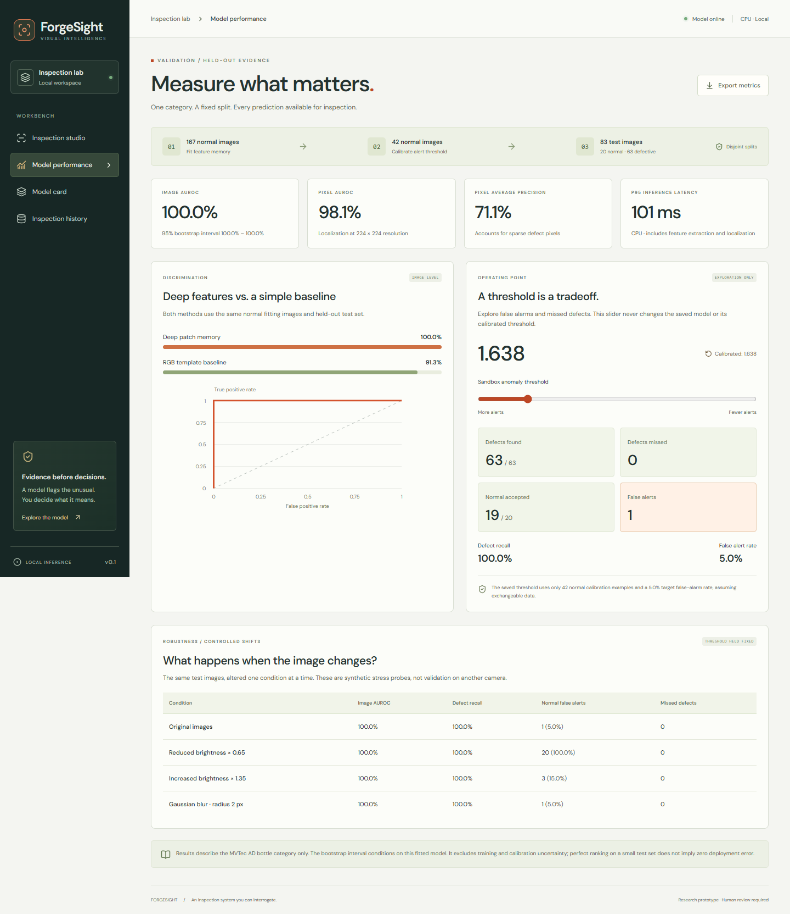
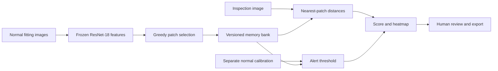

# ForgeSight

**See the defect. Inspect the evidence. Measure the model.**

A computer vision workbench for industrial inspection. ForgeSight learns normal appearance from deep image features, highlights unusual regions, and keeps the model finding separate from an operator's review.

**PyTorch · ResNet-18 · FastAPI · React · TypeScript · SQLite · Docker**



*Bottle imagery: MVTec AD, Bergmann et al. Screenshot includes an anomaly overlay; this image adaptation is licensed CC BY-NC-SA 4.0. See [attribution](THIRD_PARTY_NOTICES.md).*

## Engineering scope

- **Real model fitting:** frozen ImageNet-pretrained ResNet-18 features and a representative memory bank fitted on normal images. This is transfer-based anomaly detection, not training a CNN from scratch.
- **Separate calibration:** normal calibration images determine the alert threshold before defective test images are evaluated.
- **Measured evidence:** image/pixel metrics, an RGB baseline, bootstrap methodology, latency measurements, and lighting/blur stress tests.
- **Traceable inference:** saved model identity, score, threshold, heatmap, and append-only human review history.
- **Reproducibility:** pinned dataset revision, input checksums, deterministic split, dependency locks, artifact verification, tests, and CI workflows.
- **Usable inspection tools:** uploads, benchmark samples, original/overlay comparison, heatmaps, threshold exploration, history, and JSON export.

The method is **PatchCore-inspired**, with a smaller backbone, candidate sampling, compact coreset, and different image scoring. It does not reproduce the paper's published benchmark configuration.

## Run in PyCharm

Requirements: **Python 3.14**, Node.js 24, npm. The tested installation uses CPU PyTorch; no GPU, API key, or paid service is required. Package metadata permits Python 3.12+, but the locked environment was tested on 3.14.

Open the project folder in PyCharm and run:

```powershell
python -m venv .venv
.\.venv\Scripts\python.exe -m pip install -r requirements-torch-cpu.txt
.\.venv\Scripts\python.exe -m pip install -c requirements.lock -e ".[dev]"
npm ci --prefix web
npm run build --prefix web
.\.venv\Scripts\python.exe -m forgesight.cli setup
.\.venv\Scripts\python.exe run.py
```

Open **http://127.0.0.1:8010**. Select a sample and click **Run inspection**.

`setup` downloads the bottle dataset (~157 MB) and official weights (~45 MB), verifies the data, fits the memory bank, calibrates, and evaluates. MVTec AD is **non-commercial research data**. Dataset and weight terms are separate from the source-code license.

For this already-prepared local folder, select `.venv/Scripts/python.exe` as the PyCharm interpreter and run **`run.py`**. No refitting is needed to reopen the app.

On Linux/macOS, replace `.\.venv\Scripts\python.exe` with `.venv/bin/python`. See [setup and troubleshooting](docs/SETUP.md).

## Observed results

Fixed MVTec AD **bottle** split: 167 normal fitting images, 42 normal calibration images, and 83 test images (20 normal, 63 defective). Seed 17; 512 memory patches; 224 × 224 input. Recorded Windows CPU run: 2026-10-12.

| Measurement | Observed result |
| --- | ---: |
| Image AUROC | 1.0000 |
| RGB-template baseline image AUROC | 0.9127 |
| Pixel AUROC | 0.9813 |
| Pixel average precision | 0.7111 |
| Defects flagged at the calibrated threshold | 63 / 63 |
| Normal images incorrectly flagged | 1 / 20 |
| Median / p95 inference latency | 82.4 / 100.8 ms |

AUROC measures ranking, not classification accuracy. The decision rule is `score > 1.6383` (full precision is retained in the artifact). Latency includes preprocessing, feature extraction, nearest-neighbor search, and localization; it excludes image I/O and HTTP. These are single-machine measurements, not service capacity guarantees.

**A useful failure:** reducing brightness to 65% preserved perfect image ranking but made **20/20 normal images trigger alerts** at the original threshold. Operating-point and shift results are shown alongside AUROC.



Every test prediction is in [the recorded report](reports/bottle-baseline.json). The [evaluation protocol](docs/EVALUATION.md) explains metrics and limitations. One small category does not establish performance on new products, cameras, or production lines.

## Architecture



The server verifies artifact hashes before loading with `weights_only=True`. A single-flight inference lock rejects simultaneous inspections with HTTP 429. Reviews append to SQLite; they never modify the original score, retrain the model, or execute actions against equipment.

This is a **local, single-user service**, with no authentication or multi-tenant boundary. Keep the default loopback binding. See [architecture and operating limits](docs/ARCHITECTURE.md).

## Develop and verify

```powershell
.\.venv\Scripts\python.exe -m pytest --cov=forgesight --cov-fail-under=80
.\.venv\Scripts\python.exe -m black --check src tests scripts run.py
.\.venv\Scripts\python.exe -m isort --check-only src tests scripts run.py
.\.venv\Scripts\python.exe -m flake8 src tests scripts run.py
npm run format:check --prefix web
npm run build --prefix web
npm run test:e2e --prefix web
```

Python tests use generated fixtures without network downloads, including a real tensor-based fit/save/reload/evaluate lifecycle with an untrained test encoder. HTTP contract tests use an explicit detector test double.

Browser tests use the **real fitted model**, a temporary database, and real benchmark images. Run `setup` first. Windows defaults to installed Edge. Linux uses Chromium: from `web`, run `npx playwright install --with-deps chromium`.

Core CI runs Python tests, formatting, and the frontend build. The manually triggered **Reproduce model benchmark** workflow downloads, fits, evaluates, and runs the real-model browser suite. Hosted CI has not run until the repository is pushed and those workflows execute.

For UI hot reload, keep `run.py` running and use `npm run dev --prefix web`. API documentation is at `/docs` on port 8010.

## Model lifecycle

```powershell
python -m forgesight.cli download
python -m forgesight.cli fit
python -m forgesight.cli evaluate
python -m forgesight.cli activate --model-id MODEL_ID
python -m forgesight.cli serve
```

Use the selected virtual environment. New fits create new bundles. Restart the server after activating another model. Evaluation writes a model-specific report and updates tracked `reports/bottle-baseline.json`; review the diff before committing experiments.

## Docker

```powershell
docker compose build
docker compose run --rm forgesight setup
docker compose up -d
```

The container runs as a non-root user. Compose uses its own persistent data/model/report volumes and does not reuse the PyCharm model automatically. Port 8010 is bound to loopback; stop the PyCharm server before starting Compose on that port.

## Repository map

```text
src/forgesight/     Model, calibration, evaluation, API and persistence
web/src/           React inspection studio, performance page and model card
web/e2e/           Real-model Playwright journeys
tests/             Numerical behavior, API contracts and model lifecycle
scripts/           Isolated browser-test server
reports/           Recorded metrics and per-image scores
docs/              Setup, architecture, evaluation and screenshots
.github/workflows/ Core checks and manual benchmark reproduction
run.py             PyCharm entry point
```

Data, private uploads, records, weights, environments, IDE files, and build output are excluded from Git. Source is MIT licensed; [third-party notices](THIRD_PARTY_NOTICES.md) cover dataset imagery and upstream material.

## Next experiments

- Validate more categories using predeclared configurations and macro averages.
- Compare random patch selection with the greedy coreset at a fixed memory budget.
- Test another camera/domain and recalibrate using new normal examples.
- Add retention controls and authentication before shared deployment.

References: [PatchCore](https://arxiv.org/abs/2106.08265), [ResNet](https://arxiv.org/abs/1512.03385), [MVTec AD](https://www.mvtec.com/research-teaching/datasets/mvtec-ad).
